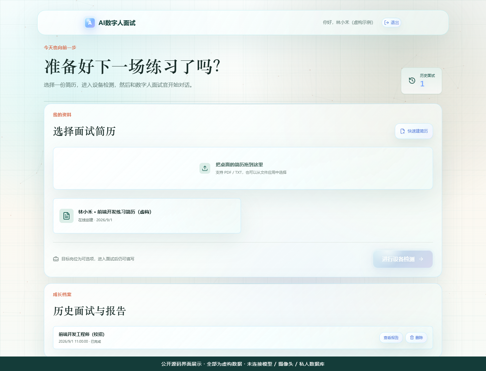
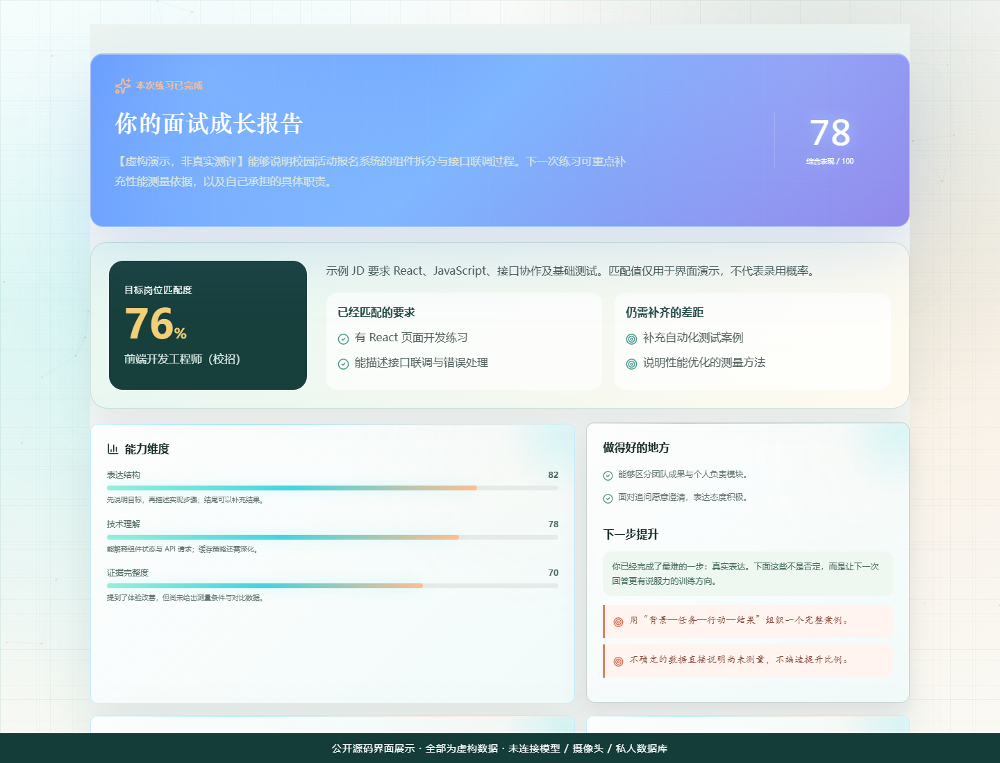
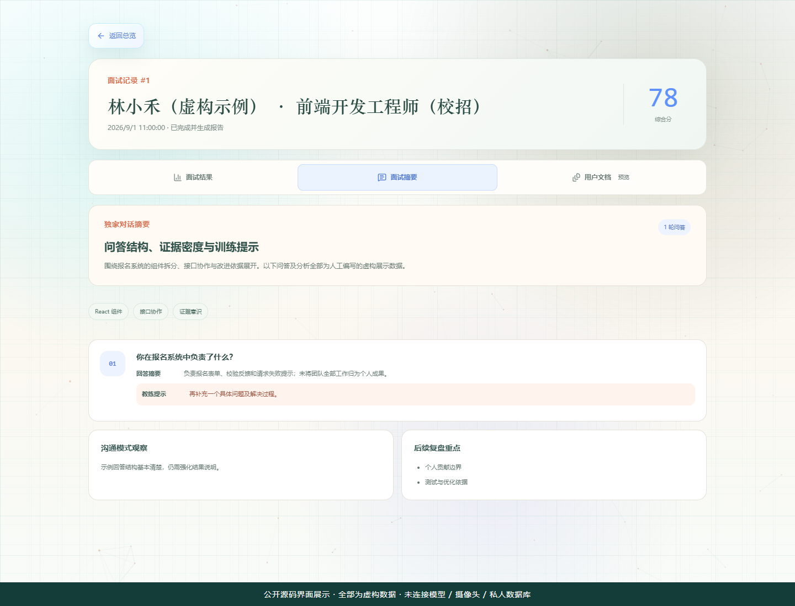

# AI数字人面试

**中文模拟面试 · 简历与岗位 JD · 数字人交互 · 成长报告**

[界面预览](docs/PREVIEW.md) · [本地运行](#windows-本地首次运行) · [功能一览](#可以研究哪些功能) · [上游致谢](#项目来源与致谢) · [问题反馈](https://github.com/les1016/ai-digital-interview/issues)

[](https://github.com/les1016/ai-digital-interview/actions/workflows/privacy-check.yml)

**一个面向大学生的中文面试练习与复盘系统，也是一份可供学习和二次开发的 Web + AI 工程实践。**

求职练习不应该停留在“回答完几个问题，得到一个分数”。本项目把简历、岗位要求、多轮追问和面试复盘串起来，让练习者知道自己说清楚了什么、还缺哪些证据，以及下一次可以怎样改进。页面保留温暖、低压力的学生成长空间风格，并提供移动端布局。

这不是实际招聘或自动筛人系统，反馈只用于练习参考。欢迎有类似需求的同学、教师和开发者借鉴、交流、提出问题。

业务代码采用 MIT 许可。此仓库是**精简源码版，不是完整免配置安装包**：包含下方展示图，不包含作者密钥、真实账号、数据库、简历、录像、完整数字人运行素材、动作视频、模型权重或商业素材包。首次填写 Key 并不意味着数字人已经部署完成。

## 数字人面试官


这是本项目选用的面试官形象，图中为静态预览。实际面试通过 LiveTalking 驱动口型并传输音视频；完整体验需要自行部署相应服务。

展示图供了解项目效果，不随业务代码 MIT 许可授予人物素材再分发权。下载源码不会获得完整数字人运行素材或模型权重。

## 项目来源与致谢

本项目的**实时数字人部分基于 [lipku/LiveTalking](https://github.com/lipku/LiveTalking) 接入并进行本地适配**。感谢 lipku 及 LiveTalking 社区贡献者提供实时音视频数字人引擎；我们不将这些底层能力声明为自行从零研发。

- **上游提供**：实时数字人驱动、音视频同步、WebRTC 等传输接口及相关模型集成。
- **本项目扩展**：面向大学生的中文面试网站，包括简历与岗位 JD、多轮追问与回答更正、暂停与恢复、报告与摘要导出、管理员测试与监控，以及面试场景的动作调度和界面交互。
- **本地适配**：对 LiveTalking 的启动、会话、ASR、音视频接口及嘴部推理链路进行了修改，以 [差异补丁](release/patches/livetalking-local.patch) 提供；基于上游提交 [a5a77f4](https://github.com/lipku/LiveTalking/commit/a5a77f4c395c8347789a16da1843cd1b08b48eea)，不是对上游最新版的兼容承诺。

这是独立维护的面试场景应用，不是 LiveTalking 官方产品，也不代表上游作者认可或背书。本仓库自己的业务代码采用 MIT；LiveTalking 原代码及相关派生修改保留其 Apache-2.0 许可边界，随附 [上游许可证与版权声明](release/patches/LiveTalking-LICENSE.txt)。Wav2Lip 等模型另有使用条件，不能用本仓库的 MIT 许可替代，详见 [第三方组件说明](docs/THIRD_PARTY.md)。

## 先看看界面

以下三张界面截图使用**虚构数据**，不是实际模型评分；截图时未连接私人数据库、模型或摄像头，也不是在线体验入口。



<details>
<summary>查看成长报告与管理员复盘</summary>

### 成长报告：保留信心，也给出下一步



### 管理员：结果、摘要、用户文档分开查看



</details>

[查看大图、演示数据说明与体验边界 →](docs/PREVIEW.md)

## 适合谁

- **求职学生 / 就业指导教学**：研究基于简历和岗位 JD 的模拟面试、回答复盘与改进建议；实际使用前需要完成部署。
- **Web 与 AI 应用开发者**：参考前后端分层、模型调用、音视频交互、会话状态、报告导出和管理端测试的实现。
- **毕业设计 / 课程实践 / 研究原型**：在理解实现和第三方许可的基础上扩展自己的方案，保留来源与版权声明。

## 可以研究哪些功能

| 模块 | 已有业务能力 |
| --- | --- |
| 面试准备 | 文本 / PDF 简历上传、拖拽导入、简历辅助填写；岗位可选，也可输入岗位 JD |
| 多轮面试 | 基于简历与岗位生成问题、追问与澄清；回答更正后的确认与上下文处理 |
| 发言与节奏 | 手动结束回答、无有效输入倒计时、暂停 / 继续、异常退出规则与冷却提示 |
| 数字人交互 | LiveTalking / WebRTC 接口；口型、动作状态调度与失败回退；可选开场、点头和微笑素材接入 |
| 复盘报告 | 面试结果、岗位匹配分析、改进建议、独立对话摘要；结果在前、摘要在后的合并文档导出（PDF / DOCX） |
| 历史与管理 | 账号与角色权限、历史面试与报告、管理员结果 / 摘要 / 用户文档预览 |
| 测试与干预 | 虚构学生固定剧本、预设答案、暂停测试、链路加载计时、状态监控、日志分页和恢复入口 |
| 工程与发布 | 本地配置窗口、启动 / 停止脚本、权限与状态回归测试、白名单源码导出、上传前离线脱敏检查 |

上表描述源码中的功能，不代表公开副本已附带所有外部服务和媒体。手机 / iPad 的麦克风、摄像头与 WebRTC 还需要合适的 HTTPS、证书和浏览器权限；桌面运行成功不等于移动端已经配置完成。

典型练习流程：

```text
上传 / 填写简历 + 可选岗位 / JD
              ↓
规则说明 → 面试提问 ↔ 用户回答 / 澄清 / 更正
              ↓
面试结果 + 对话摘要 + 可执行改进建议
              ↓
查看历史 / 导出合并文档 / 再次练习
```

## 技术与目录

- 前端：React / Vite / JavaScript；浏览器媒体采集和 WebRTC；桌面与移动端布局。
- 后端：Python / FastAPI / SQLAlchemy；本地 SQLite；DeepSeek 对话接口与结构化结果校验。
- 数字人：对接 LiveTalking；本地修改以补丁提供，模型和人物素材需自行合法准备。
- 固定剧本：虚构学生数据，不调用 DeepSeek；语音服务与数字人仍需配置。
- `apps/` 业务源码；`scripts/` 运行与发布工具；`tests/` 回归测试；`release/` 发布模板；`docs/` 安全与依赖说明。

浏览器通过后端使用模型服务，**不把服务商 Key 下发到前端**。数据库、上传文件和运行日志由部署者保存在自己的环境中；本仓库不提供共享 API、托管服务器或演示账号。

## Windows 本地首次运行

1. 安装 Python 3.11–3.12（需要 tkinter）、uv、Node.js 22.12+、pnpm 11.9.0。版本约束以锁文件和项目清单为准。
2. 双击“一键初始化.cmd”安装锁定依赖并构建前端；需要联网，不会自动修改代理或支付费用。
3. 双击“配置密钥与管理员.cmd”：中文窗口填写**你自己的** DeepSeek Key、新管理员账号与密码。Key 保存到项目根目录私有 `.env`，密码只保存加盐哈希。已有管理员不会被此窗口覆盖；取消不会启动服务。不要在网页前端配置服务商 Key。
4. 先阅读 `docs/THIRD_PARTY.md`，部署 LiveTalking 环境、应用补丁并准备有授权的人物与权重。未准备人物时，图片/动作区域可能为空或回退；不能据此认为实时面试完整可用。
5. 双击“一键启动.cmd”。缺少本地配置时会自动弹出配置窗口。页面默认为 http://127.0.0.1:4173 。管理员使用自己设定的账号登录。

仅研究业务页面/API 时，完成第 1–3 步后双击“仅启动网页与后端.cmd”：不启动 WSL、数字人和语音服务，也不等待它们加载。这不是完整语音面试模式；数字人、口播和部分录音链路不可用。实时文本面试仍可能调用你配置的 DeepSeek API 并计费。

开发者也可分别在 `apps/server` 启动 `python -m uvicorn app.main:app --host 127.0.0.1 --port 8000`，在 `apps/web` 运行 `pnpm dev`。完整启动器会检查数字人源码是否存在，缺失时直接提示，不再等到超时。所有首次启动都必须先完成本机配置。

若端口 8000/4173 已被另一份项目占用，启动器会拒绝复用，以免公开副本连接到私有项目的数据。请先从原项目停止服务；不会自动结束别人的进程。项目路径支持中文和空格。

DeepSeek Key 不是会员资格或免费额度；真实面试可能计费。配置窗口只校验输入格式，不验证额度或 Key 是否有效。更改运行中服务的 Key 后需要重启服务。本地金额熔断是估算保护，不替代服务商账单限额；上线前核对模型名称、价格和预算配置。

## 测试与再次发布

```text
python -m unittest discover -s tests -p "test_*.py"
node --test tests/acknowledgment_player.test.mjs tests/smile_actions.test.mjs tests/opening_policy.test.mjs tests/admin_avatar_load.test.mjs
python scripts/public_release.py
python scripts/public_release.py --output <一个尚不存在的源码输出目录>
python scripts/public_release.py --check-tree <待上传的精简源码目录>
```

检查不联网、不调用付费 API、不上传文件。只允许清单中的文件进入公开副本；新文件须经过人工审核后加入清单。不要直接上传日常运行项目目录或“导师交付打包”产生的其他压缩包。

首次安装回归测试会在临时目录创建虚构账号、启动短暂的本机随机端口 API，验证健康、登录和权限，并在结束时停止。它不使用真实 Key，不请求外部服务，也不使用项目默认数据库。

Windows 也可双击“发布前检查.cmd”，或“导出GitHub源码.cmd”生成 D 盘的新精简源码目录；不会覆盖旧目录或自动上传。

自动规则无法识别所有个人信息，也不证明所有素材都有再分发授权。发布前仍须阅读 `SECURITY.md`，人工复核源码、README、截图与 Git 历史。随附 GitHub Actions 工作流会在仓库启用 Actions 后检查当前提交的源码；它发生在上传之后，不能替代上传前检查，也未检查历史。还可自行启用 secret scanning / push protection（若可用），或另行配置 GitGuardian。不要将整个私有工作目录提交到云端扫描器。

## 限制

本地原型不等于可直接公网生产部署。公开部署前需要 HTTPS、认证与权限复核、成本控制、日志脱敏、备份与恢复验证，以及适当的模型许可。面部/行为信号只能作为练习反馈，不能作为心理诊断或招聘决策依据。

模型可能误解回答、产生不准确的评分或建议，岗位匹配度也不是录用概率。涉及真实用户时，应明确告知采集内容、保存期限及删除方式；不要在未经同意的情况下采集或公开简历、声音和面部录像。

本项目业务代码的 MIT 许可**不等于整套数字人和全部依赖都可商用**。例如 Wav2Lip 开源版本的使用限制、其他模型权重和人物素材的权利需要分别核对，详情见 [第三方组件说明](docs/THIRD_PARTY.md)。

## 交流与贡献

欢迎通过 Issues 交流应用场景、复现问题和改进思路，也欢迎提交小范围、可验证的修复。建议说明系统 / 浏览器版本、启动方式、复现步骤、预期与实际表现。

提交问题、日志或截图前，请先去除 Key、Cookie、账号、真实简历、对话原文以及可识别个人的信息。用虚构数据复现；**不要把密钥或真实用户资料发到公开 Issue / PR**。发现安全问题时不要公开可利用细节或他人数据，请先私下联系维护者。发布流程与安全边界见 [SECURITY.md](SECURITY.md)。
